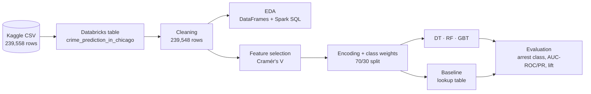
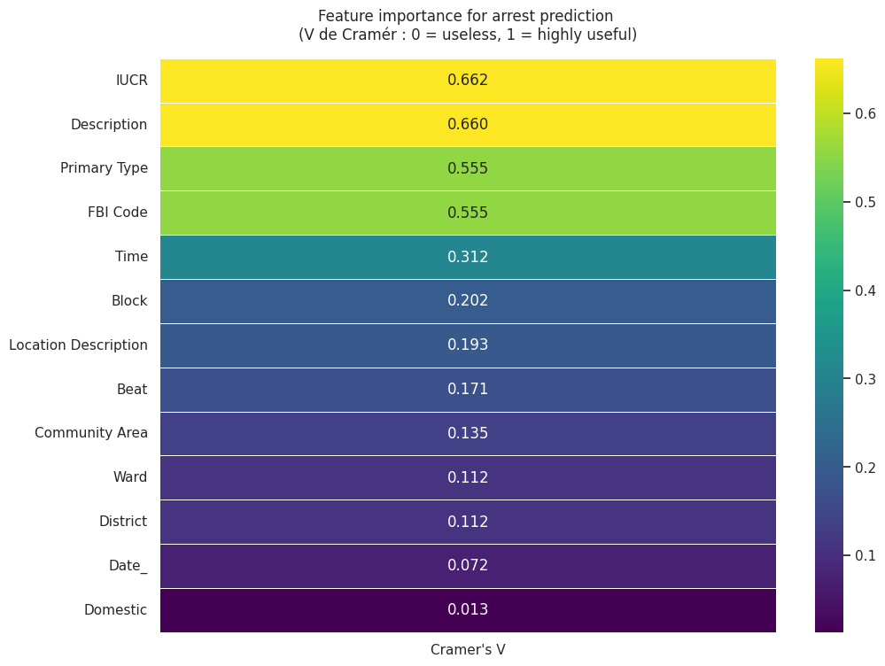
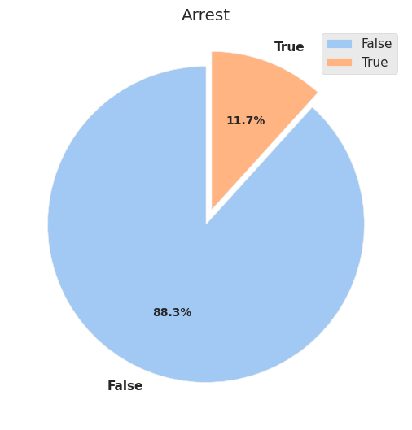
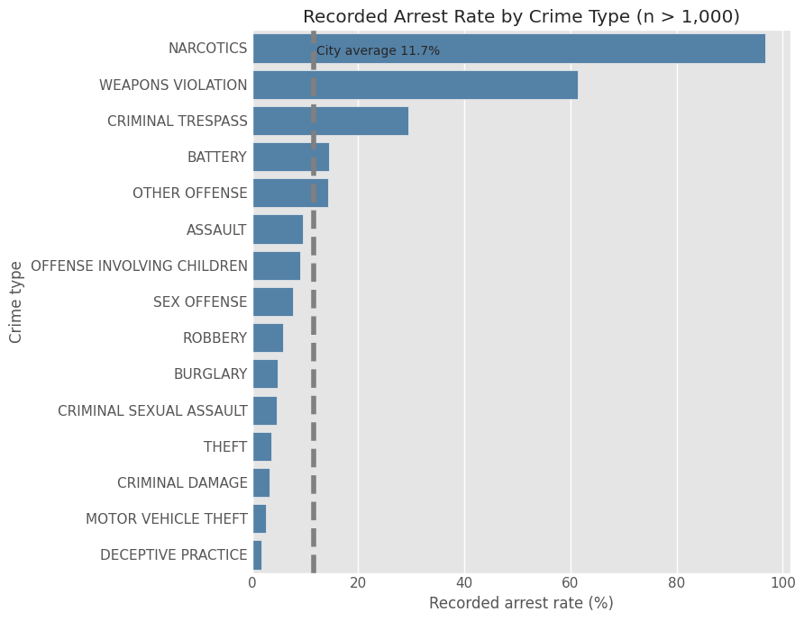
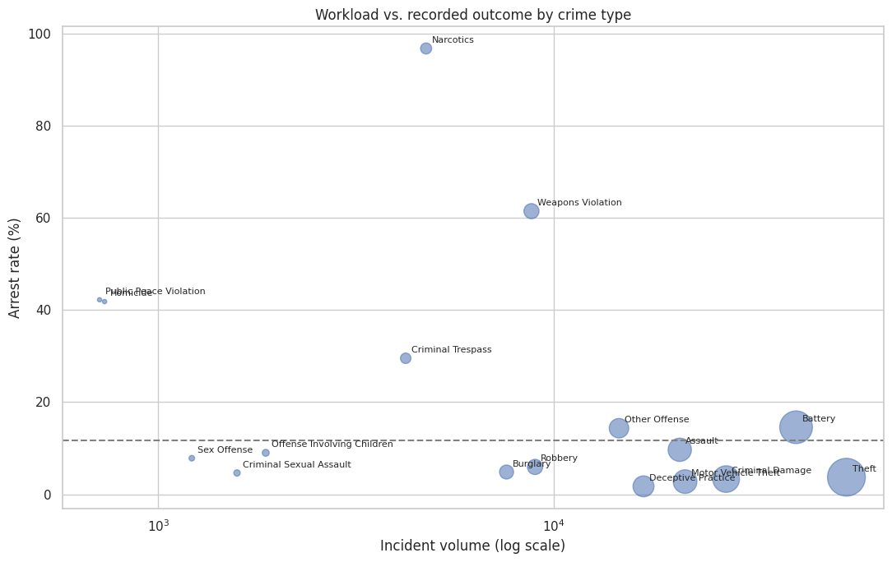
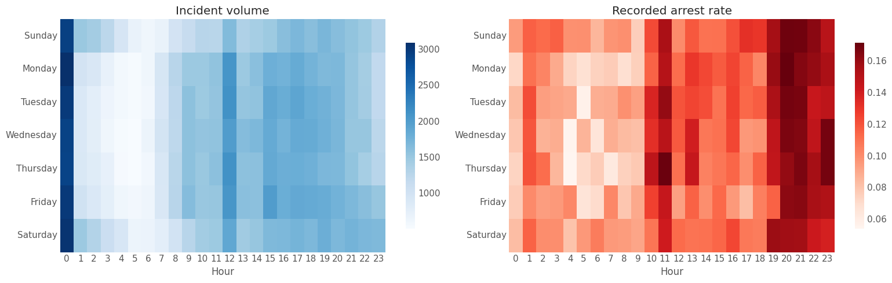
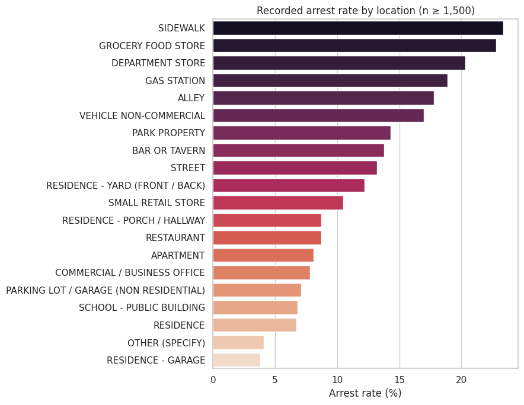
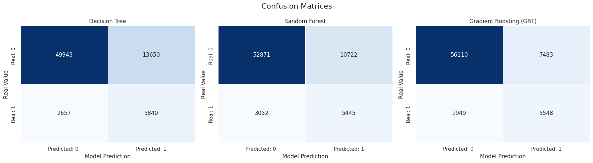
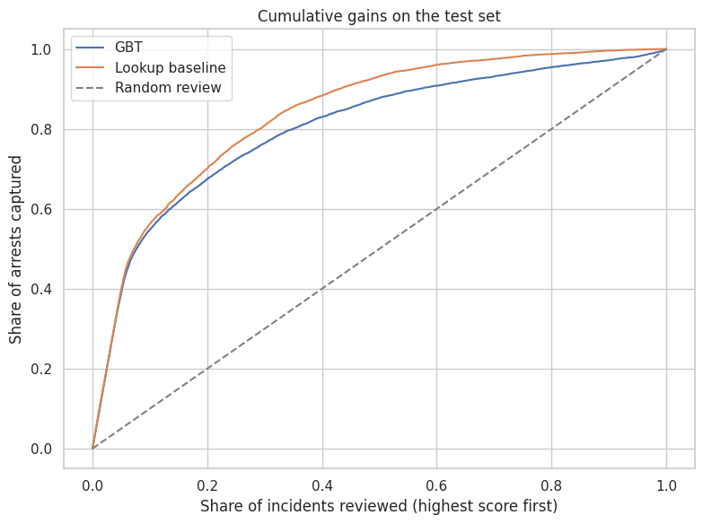

<div align="center">

# 🚔 Predicting Arrest Outcomes in Chicago with Apache Spark

**Descriptive & predictive analytics on 239,548 Chicago crime reports (2022) using Spark DataFrames, Spark SQL and Spark MLlib**


*Big Data and Cloud Computing – Final Project*

**Team:** ÖHRN IBARRA Alicia · LE CHEVALLIER Ethan · RABIER Martin

</div>

---

## 📑 Table of Contents

1. [Project at a Glance](#-project-at-a-glance)
2. [Quick Start – Execution Guide](#-quick-start--execution-guide)
3. [Repository Contents](#-repository-contents)
4. [Methodology](#-methodology)
5. [Key Findings](#-key-findings)
6. [Model Results](#-model-results)
7. [Business Implications](#-business-implications)
8. [Limitations & Responsible Use](#-limitations--responsible-use)
9. [Troubleshooting](#-troubleshooting)

---

## 🎯 Project at a Glance

### Research question

> **Which characteristics of reported crime incidents in Chicago are associated with a recorded arrest, and how accurately can Apache Spark MLlib classify incidents according to this outcome?**

### Two objectives

| | Objective | Approach |
|---|---|---|
| 🔍 | **Descriptive analytics** | Identify differences in recorded arrest rates by crime type, time, location and domestic context |
| 🤖 | **Predictive analytics** | Compare ML models that estimate the probability of a recorded arrest from incident characteristics |

### Headline results

| Metric | Value |
|---|---|
| Records analysed | **239,548** (239,558 before cleaning) |
| Overall recorded arrest rate | **11.7 %** |
| Best MLlib model | **Gradient-Boosted Trees** – AUC-ROC **0.844**, precision 0.43, recall 0.65 (arrest class) |
| Simple baseline (arrest rate by crime type × description) | AUC-ROC **0.885** → **beats every ML model** |

> 💡 **Take-away:** with the variables available, the *type of offence* explains almost everything that can be predicted. Machine learning adds no value over a transparent lookup table.

---

## 🚀 Quick Start – Execution Guide

The notebook was developed and run on **Databricks**. It reads the dataset from a **table in the workspace's `default` schema**, so the data must be loaded *before* running any cell. However, the code features a commented lab allowing the user to load the data from its own workspace.

### Prerequisites

| Requirement | Details |
|---|---|
| **Platform** | A Databricks workspace (the notebook relies on `display()` and `spark.table()`) |
| **Compute** | A cluster running **Databricks Runtime 13.x or later** (Spark ≥ 3.4 – the notebook uses `F.mode`, introduced in Spark 3.4) |
| **Python libraries** | `pandas`, `numpy`, `matplotlib`, `seaborn`, `pyspark` – all available by default on Databricks Runtime |
| **Dataset** | `Crime Prediction In Chicago_Dataset.csv` from Kaggle *(see step 1)* |

### Step 1 – Download the dataset

Download **`Crime Preidction In Chicago_Dataset.csv`** from the Kaggle page *Crime Prediction in Chicago*:

🔗 **Kaggle:** [Crime Prediction in Chicago in 2022](https://www.kaggle.com/datasets/georgehanyfouad/crime-prediction-in-chicago-in-2022/data)

The file contains **239,558 rows × 22 columns** of 2022 Chicago crime reports.

### Step 2 – Load the CSV as a table in Databricks

1. In the Databricks sidebar go to catalog and in the top right corner click **➕ New → Add or upload data → Create or modify table**.
2. Upload the CSV file.
3. In the destination settings, choose:
   - **Catalog:** `workspace` *(your default catalog)*
   - **Schema:** `default`
   - **Table name:** `crime_prediction_in_chicago` ⚠️ *must match exactly*
4. Keep the **original column names** (e.g. `Primary Type`, `Location Description`) and make sure the inferred types match the table below, then click **Create table**.

<details>
<summary><b>Expected table schema (click to expand)</b></summary>

| Column | Type | Column | Type |
|---|---|---|---|
| `ID` | bigint | `Beat` | bigint |
| `Case Number` | string | `District` | bigint |
| `Date` | string | `Ward` | bigint |
| `Block` | string | `Community Area` | bigint |
| `IUCR` | string | `FBI Code` | string |
| `Primary Type` | string | `X Coordinate` / `Y Coordinate` | bigint |
| `Description` | string | `Year` | bigint |
| `Location Description` | string | `Updated On` | string |
| `Arrest` | **boolean** | `Latitude` / `Longitude` | double |
| `Domestic` | **boolean** | `Location` | string |

</details>

Quick check from any notebook cell:

```python
spark.table("crime_prediction_in_chicago").count()   # expected: 239558
```

### Step 3 – Import and run the notebook

1. In your workspace, go to **Workspace → Import** and upload the notebook.
2. Attach it to your cluster (see prerequisites).
3. Click **Run all**.

The notebook runs top to bottom with no manual intervention. Random seeds are fixed (`seed=42`), so the train/test split and model results are reproducible.

### Notebook map

| Section | Content |
|---|---|
| **1** | Data source and loading |
| **2** | Data quality assessment and preprocessing |
| **3** | Exploratory data analysis (univariate, bivariate, Spark SQL, proactive vs. reactive offences) |
| **4** | Feature engineering, imbalance handling and model training |
| **5** | Results and model comparison (incl. baseline, lift and robustness checks) |
| **6–8** | Business implications, limitations and conclusion |

---

## 📂 Repository Contents

```text
.
├── Project_Sandbox.ipynb     # Main Databricks notebook (full analysis)
├── README.md                 # This file – execution guide + mini-report
└── images/                   # Figures extracted from the notebook outputs
```

---

## 🧪 Methodology



### 1. Data cleaning

| Decision | Rationale |
|---|---|
| Drop `Year`, `Updated On` | `Year` has a single value (2022); `Updated On` is administrative |
| Drop `Case Number`; keep `ID` for traceability only | Near-unique per row (239,511 distinct case numbers) → no predictive meaning |
| Parse `Date` with `to_timestamp(..., "M/d/yyyy H:mm")` | Raw format is a string |
| Strip house numbers from `Block`; drop X/Y, latitude/longitude, `Location` | Exact coordinates missing for 4,667 rows (1.9 %); street-level view is sufficient (~2,460 distinct streets) |
| Drop 10 rows with missing `Ward` | Only 0.004 % of the data |
| Fill 965 missing `Location Description` with the mode (`STREET`) | Only 0.4 % of rows |

```python
# Example: normalising the Block column and handling missing values
work_df = work_df.withColumn("Block", F.regexp_replace(F.col("Block"), "^\\S+\\s+", ""))
work_df = work_df.dropna(subset=["Ward"])
mode_value = work_df.select(F.mode("Location Description")).first()[0]
work_df = work_df.na.fill({"Location Description": mode_value})
```

### 2. Feature selection

Associations between each candidate variable and `Arrest` were measured with a **χ² test converted to Cramér's V** (computed natively in Spark with `ChiSquareTest`).

<p align="center"></p>

**Kept:** `Primary Type`, `Description`, `Location Description`, `Block`, `Beat`, `Ward`, `District`, `Date_`, `Time`, `Domestic`
**Removed:** `ID`, `IUCR`, `FBI Code`, `Community Area` (identifier or duplicate information)

### 3. Handling class imbalance

Only **11.7 %** of incidents lead to an arrest. Always predicting "no arrest" would be right ~88 % of the time while detecting nothing.

<p align="center"></p>

SMOTE is not available in MLlib (and interpolating between encoded categories would be meaningless), so **inverse-frequency class weights** are used:

```python
ml_df_weighted = ml_df_encoded.withColumn(
    "weight",
    F.when(F.col("label") == 1, total / (2 * count_1)).otherwise(total / (2 * count_0))
)
train_data, test_data = ml_df_weighted.randomSplit([0.7, 0.3], seed=42)
```

### 4. Models and evaluation

| Model | Implementation |
|---|---|
| Decision Tree | `DecisionTreeClassifier` |
| Random Forest | `RandomForestClassifier` |
| Gradient Boosting | `GBTClassifier` (Spark-native alternative to XGBoost) |
| **Baseline** | Smoothed historical arrest rate per *(Primary Type × Description)* – no ML |

All models use `weightCol="weight"`, `maxBins=3000` and `seed=42`. Evaluation is done on the **arrest class** (precision, recall, F1) plus **AUC-ROC** and **AUC-PR**, which suit an imbalanced target – accuracy is deliberately *not* used as the main criterion.

---

## 📊 Key Findings

### 1️⃣ Crime type is the dominant driver of arrests

Narcotics (96.7 %), Weapons Violation (61.4 %) and Criminal Trespass (29.5 %) are the only types far above the 11.7 % city average.

<p align="center"></p>

The workload-versus-outcome gap is striking: **four property crimes** (Theft, Motor Vehicle Theft, Criminal Damage, Deceptive Practice) represent **50.3 % of all incidents (120,447)** but only **3.2 % of them lead to an arrest** (3,802 arrests).

<p align="center"></p>

### 2️⃣ Time and place matter far less

| Dimension | Observation |
|---|---|
| **Hour** | Lowest at 04:00–06:00 (7.9–8.1 %), highest 19:00–23:00 (14.8–16.5 %) |
| **Day of week** | Almost flat (11.0 % Friday → 12.3 % Sunday) – weak signal |
| **Month** | Peaks in May (14.3 %), lowest in Oct–Nov (9.7–9.8 %) |
| **Location** | Public/commercial: sidewalk 23.4 %, grocery 22.8 %, gas station 18.9 %. Private: residence 6.7 %, apartment 8.1 % |
| **Domestic** | 12.6 % vs 11.5 % – statistically significant (z ≈ 6.4) but only +1.1 pt |

<p align="center"></p>

> ⚠️ Hour 0 has 20,874 incidents vs. 7,630 at hour 1: many timestamps seem to default to 00:00 – this is **not** a real crime peak.

<p align="center"></p>

### 3️⃣ District comparisons must be adjusted for crime mix

Raw arrest rates range from **7.6 % (district 19) to 23.2 % (district 11)** – a 3× gap. Once expected arrests are computed from the city-wide rate of each crime type, the observed/expected ratio only ranges from **0.80 (district 3) to 1.40 (district 1)**: most of the gap comes from case mix, not district performance.

### 4️⃣ Proactive vs. reactive offences

| Group | Share of incidents | Share of arrests | Arrest rate |
|---|---|---|---|
| Narcotics, weapons, trespass ("proactive-type") | 7.4 % | **40.1 %** | high |
| All other crimes (victim-reported) | 92.6 % | 59.9 % | **7.6 %** |

For proactive-type offences the arrest is often *how the offence is detected*, so predicting it is close to circular. Model performance is therefore also reported separately for each group.

---

## 🏆 Model Results

All models were evaluated on the same test set: **72,090 incidents**, of which **8,497 (11.8 %)** led to an arrest.

| Model | Precision | Recall | F1 | AUC-ROC | AUC-PR |
|---|:---:|:---:|:---:|:---:|:---:|
| 🥇 **Baseline: lookup (type × description)** | n/a | n/a | n/a | **0.885** | **0.678** |
| 🥈 Gradient Boosting (GBT) | 0.426 | 0.653 | 0.515 | 0.844 | 0.635 |
| Random Forest | 0.337 | 0.641 | 0.442 | 0.831 | 0.567 |
| Decision Tree | 0.300 | 0.687 | 0.417 | 0.714 | 0.499 |

*Precision, recall and F1 are computed on the arrest class.*

<p align="center"></p>

**Reading the results**

- **GBT is the best MLlib model**: fewest false alarms (7,483 vs. 10,722 for RF and 13,650 for DT), ~1.4 false alarms per arrest found.
- **Accuracy is misleading**: GBT reaches 85.5 %, less than the trivial "always no arrest" rule (88.2 %) – the price paid for class weighting to actually detect arrests.
- **The simple baseline wins**: the street, beat, ward, date and time information does not bring any measurable gain, and may even add noise.

### Prioritisation (cumulative gains)

<p align="center"></p>

| Share of incidents reviewed (highest score first) | Arrests captured – Baseline | Arrests captured – GBT |
|---|:---:|:---:|
| Top 10 % | 56 % | 55 % |
| Top 20 % | **70 %** | 67 % |
| Top 30 % | **81 %** | 76 % |

A random review of 20 % of incidents would capture only 20 % of arrests.

### Robustness by offence group

| Group | Test incidents | Arrest rate | GBT AUC-ROC | Baseline AUC-ROC |
|---|---:|---:|:---:|:---:|
| Narcotics, weapons, trespass | 5,383 | 62.9 % | 0.916 | 0.928 |
| All other crimes (victim-reported) | 66,707 | 7.7 % | 0.763 | **0.823** |

The overall score is flattered by the "easy" circular cases. On the 93 % of incidents that are victim-reported, performance drops for both approaches and the simple rule keeps its lead.

---

## 💼 Business Implications

1. **Where to look first** – property crimes are half of all incidents with a 3.2 % arrest rate. The data shows the gap but cannot explain it.
2. **Track volumes *and* arrest rates together**, by crime category.
3. **Compare districts with crime-mix-adjusted indicators**, never raw arrest rates.
4. **Prefer a transparent rule to a complex model** unless richer data shows a clear gain – a lookup table is as effective here and can be audited line by line.
5. **Investigate high-volume / low-arrest contexts** (e.g. early mornings, residential settings).

> 🛑 A score never proves that an arrest will or should happen. It must not be used to deny an investigation, justify coercive action or label people as suspicious. Any model should support human judgement, never replace it.

---

## ⚠️ Limitations & Responsible Use

<details>
<summary><b>Data limitations</b></summary>

- One city, one year – results may not generalise.
- The target records whether an arrest is linked to an incident, **not** how solvable a crime is.
- Default `00:00` timestamps limit time-of-day analysis.
- Narcotics/weapons/trespass offences are often recorded *because of* the arrest (partly circular target).
- Several incidents may belong to the same case (not fully independent).

</details>

<details>
<summary><b>Modeling limitations</b></summary>

- Random train/test split (incidents from the same period/area in both sets); no test on later months.
- Default hyper-parameters, no cross-validation.
- Class weighting may distort predicted probabilities.
- Exact date and time encoded as high-cardinality categories (possible noise).
- Associations are not causes.

</details>

<details>
<summary><b>Fairness</b></summary>

Geographic variables can reflect historical differences in police activity, reporting and enforcement. A high score for a *recorded arrest* is not evidence that a person is more likely to commit a crime. Any real deployment would require independent validation, a fairness audit, human oversight and a legal and ethical review.

</details>

**Suggested next steps:** validate on later months, use multi-year data, tune the models, and test richer information (evidence, response time, victim/offender context) not present in this dataset.

---

## 🛠 Troubleshooting

| Problem | Likely cause / fix |
|---|---|
| `AnalysisException: Table or view not found: crime_prediction_in_chicago` | The table name or schema is wrong. It must be `crime_prediction_in_chicago` in the catalog/schema the notebook uses by default (`default`) |
| `Column 'Primary Type' cannot be resolved` | Column names were renamed during upload (e.g. spaces → underscores). Re-create the table keeping the original names |
| `Arrest` / `Domestic` read as strings | Re-create the table with schema inference enabled, or cast to boolean at load |
| `AttributeError: ... has no attribute 'mode'` | Cluster runtime too old – use Databricks Runtime 13.x or later (Spark ≥ 3.4) |
| `display()` is not defined | The notebook is being run outside Databricks. Replace `display(df)` with `df.show()` / `df.toPandas()` |
| Seaborn `FutureWarning` about `palette` | Harmless – plotting deprecation notice |

---

<div align="center">

**Big Data and Cloud Computing – Final Project** · Built with Apache Spark on Databricks

*Data source: Chicago Police Department reports, via Kaggle*

</div>
